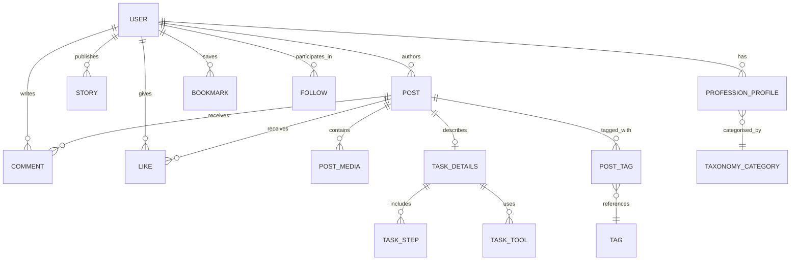

# MyJob System Architecture & Design Specification

## 1. System Overview

**MyJob** is a profession-centric, media-driven social platform that allows verified workers and professionals across any discipline (trades, law, medicine, transport, tech, finance) to showcase both their daily life and their specialized craft.

### 1.1 The 3-Tier Worker Content Model
Every worker account has three distinct modes of publishing:
1. **Day-to-Day Stories (24h Ephemeral)**:
   - Quick, relatable snaps of daily work routines (e.g., getting morning coffee, commuting to a court hearing, setting up tools in a van, reviewing meeting notes).
2. **General Feed Posts (Milestones & Achievements)**:
   - Permanent photo & text posts sharing career updates, trial verdicts, passed certifications, workplace humor, and milestone reflections.
3. **Professional Deep-Dive Case Studies & Task Walkthroughs (The Core Differentiator)**:
   - High-value, structured professional breakdowns where true expertise is demonstrated (e.g., *"How to draft and serve an enforceable Subpoena Duces Tecum"*, *"Diagnosing hydraulic water hammer in high-rise plumbing"*, *"Handling emergency detour dispatching"*).
   - Includes: Problem context, statutory/tool references, step-by-step methodology, and expert pro-tips.

### 1.2 The Explorer / Follower Experience & Community Collaboration
The average user on MyJob is an explorer, learner, peer, or client who interacts with professionals in rich, structured ways:

1. **Profession Observation & Career Discovery**:
   - Follow specific practitioners (e.g., litigators, HVAC technicians, bus drivers) or whole profession tags (`#Plumbing`, `#Litigation`).
   - Watch authentic behind-the-scenes stories to understand the daily routine, stress points, and joys of any career.
2. **Professional Ratings & Peer Reviews**:
   - Rate the clarity and technical accuracy of published task walkthroughs and case studies (1-5 stars with feedback).
   - Peer badges distinguish general feedback from verified peer reviews (e.g. another verified lawyer reviewing a legal brief strategy).
3. **Interactive Worker Q&A Segments (AMA)**:
   - Followers submit targeted questions about career path, required certifications, salary expectations, tool choices, or case advice.
   - Workers answer via text or short video clips that attach directly to their profession hub.
4. **Crowdsourced Challenges & Live Problem Solving**:
   - Workers can post live or stubborn workplace dilemmas (e.g., *"Unexplained hydraulic noise at 3 AM"*, *"Rare contract indemnification loophole"*).
   - Followers and peers submit solution hypotheses, tool recommendations, and feedback.
   - The worker can formally accept the winning solution and award community credibility points.

---

## 2. High-Level Architecture Diagram

```
+-------------------------------------------------------------------------+
|                              Clients                                    |
|         (Web: React/TypeScript  |  Mobile: iOS / Android / PWA)         |
+------------------------------------+------------------------------------+
                                     |
                                HTTPS / WSS
                                     |
+------------------------------------v------------------------------------+
|                         FastAPI Application Gateway                     |
|                                                                         |
|  +------------------+  +-------------------+  +----------------------+  |
|  | Auth & Profiles  |  | Feed & Discovery  |  | Posts & Task Guides  |  |
|  +------------------+  +-------------------+  +----------------------+  |
|  +------------------+  +-------------------+  +----------------------+  |
|  | Stories Engine   |  | Social & Comments |  | Taxonomy & Search    |  |
|  +------------------+  +-------------------+  +----------------------+  |
+----------------------+-------------------+------------------------------+
                       |                   |
            +----------v---------+  +------v---------------+
            |  Redis (In-Memory) |  | PostgreSQL + pgvector|
            |                    |  |                      |
            | - 24h Story Index  |  | - Persistent Records |
            | - Rate Limiting    |  | - Users & Professions|
            | - Feed Cache       |  | - Full-Text Search   |
            | - Live View Counts |  | - Task Workflows     |
            +--------------------+  +----------------------+
                       |
            +----------v---------------------------+
            | Async Media Pipeline (Celery / ARQ)  |
            | - Image Optimization (WebP)          |
            | - Video Transcoding (HLS/MP4)        |
            | - S3-Compatible Media Bucket Storage |
            +--------------------------------------+
```

---

## 3. Data Models & Entity Relationship



### Key Entities:

1. **User (`users`)**:
   - `id` (UUID, PK)
   - `username` (VARCHAR, Unique)
   - `email` (VARCHAR, Unique)
   - `hashed_password` (VARCHAR)
   - `full_name` (VARCHAR)
   - `avatar_url` (VARCHAR)
   - `bio` (TEXT)
   - `created_at`, `updated_at`

2. **Profession Profile (`profession_profiles`)**:
   - `id` (UUID, PK)
   - `user_id` (UUID, FK -> users.id)
   - `industry` (VARCHAR, e.g., "Trades", "Tech", "Healthcare", "Legal")
   - `job_title` (VARCHAR, e.g., "Master Plumber", "Senior DevOps Engineer")
   - `specialization` (VARCHAR)
   - `years_of_experience` (INT)
   - `is_verified_pro` (BOOLEAN)
   - `company_or_freelance` (VARCHAR)

3. **Story (`stories`)**:
   - `id` (UUID, PK)
   - `user_id` (UUID, FK -> users.id)
   - `media_url` (VARCHAR)
   - `media_type` (ENUM: image, video)
   - `caption` (VARCHAR)
   - `task_tag` (VARCHAR, optional)
   - `created_at` (TIMESTAMP)
   - `expires_at` (TIMESTAMP: `created_at + 24 hours`)
   - `is_pinned_highlight` (BOOLEAN)
   - `highlight_collection_name` (VARCHAR, optional)

4. **Post (`posts`)**:
   - `id` (UUID, PK)
   - `author_id` (UUID, FK -> users.id)
   - `title` (VARCHAR)
   - `caption` (TEXT)
   - `post_type` (ENUM: standard_post, task_walkthrough, reel)
   - `likes_count` (INT)
   - `comments_count` (INT)
   - `created_at`, `updated_at`

5. **Task Details & Workflow Steps (`task_details`, `task_steps`)**:
   - `task_details.id` (UUID, PK)
   - `task_details.post_id` (UUID, FK -> posts.id)
   - `task_details.difficulty` (ENUM: beginner, intermediate, advanced, expert)
   - `task_details.estimated_duration_mins` (INT)
   - `task_details.problem_description` (TEXT)
   - `task_steps`: `[ { step_number: 1, title: "...", description: "...", image_url: "..." } ]`
   - `task_tools`: `[ "Pipe Wrench", "PTFE Tape", "Blowtorch" ]`

---

## 4. API Specification Overview

### 4.1 Authentication & Profile
- `POST /api/v1/auth/register` - Create new user account with profession details
- `POST /api/v1/auth/login` - Authenticate & obtain JWT access token
- `GET  /api/v1/users/{username}` - Get user public profile and profession stats
- `PATCH /api/v1/users/me/profession` - Update profession title, verification, and skills

### 4.2 Stories & Ephemeral Updates
- `GET  /api/v1/stories/feed` - Get active 24h stories from followed accounts and top professions
- `POST /api/v1/stories` - Upload a new 24h story (with automatic 24h expiration)
- `POST /api/v1/stories/{story_id}/pin` - Pin story into a permanent profile highlight
- `GET  /api/v1/stories/highlights/{user_id}` - Get user's pinned workflow highlights

### 4.3 Posts & Task Walkthroughs
- `GET  /api/v1/posts/feed` - Main personalized/profession feed
- `POST /api/v1/posts` - Create post or detailed task walkthrough with multi-step workflows
- `GET  /api/v1/posts/{post_id}` - Get post details with task breakdown and comments
- `POST /api/v1/posts/{post_id}/like` - Like or unlike a post
- `POST /api/v1/posts/{post_id}/bookmark` - Save post to private collection

### 4.4 Profession Discovery & Taxonomy
- `GET  /api/v1/discovery/professions` - List all profession categories and active workers
- `GET  /api/v1/discovery/feed?profession={slug}&industry={slug}` - Filter feed by specific job
- `GET  /api/v1/discovery/search?q={query}` - Search across professions, tools, and task guides

---

## 5. Ephemeral Stories & Caching Strategy

```
User uploads story -> Saved to PostgreSQL with expires_at (NOW + 24h)
                   -> Added to Redis Sorted Set: ZADD stories:active <timestamp_epoch> <story_id>
                   -> Read requests query Redis for O(1) active story lookups
                   -> Expired stories cleanly filter out via Redis range queries
```
